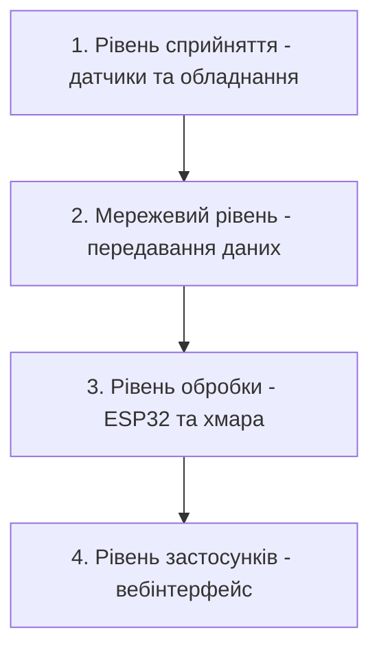

# Практична робота №1
**Студент:** Максим Братішко
**Дисципліна:** Технології IoT та SMART-технології

**Тема:** Вступ до IoT та SMART-технологій

**Варіант 1:** Розумна теплиця (200 м²)

## 1. Мета роботи

Розробити проєкт розумної теплиці площею 200 м², яка автоматично контролюватиме умови вирощування рослин та підтримуватиме необхідний мікроклімат.

## 2. Опис системи

Розумна теплиця — це IoT-система, яка за допомогою датчиків збирає інформацію про стан навколишнього середовища та автоматично керує обладнанням.

Система контролює:
- температуру повітря;
- вологість повітря;
- вологість ґрунту;
- рівень освітленості;
- концентрацію CO₂.

На основі показань датчиків система може:
- вмикати полив, якщо ґрунт занадто сухий;
- запускати вентиляцію при підвищенні температури;
- вмикати додаткове освітлення при нестачі світла;
- запускати обігрів при зниженні температури.

Керування здійснюється автоматично, але користувач також може переглядати показники та змінювати налаштування через вебінтерфейс.

## 3. Склад системи

| Пристрій | Призначення | Розміщення |
|---|---|---|
| Датчик температури та вологості повітря | Вимірювання температури й вологості | Усередині теплиці |
| Датчик вологості ґрунту | Контроль необхідності поливу | У ґрунті біля рослин |
| Датчик освітленості | Визначення рівня природного світла | У верхній частині теплиці |
| Датчик CO₂ | Контроль концентрації вуглекислого газу | У центральній частині теплиці |
| Контролер ESP32 | Збір даних та автоматичне керування | У захищеному корпусі |
| Електромагнітний клапан | Увімкнення та вимкнення поливу | На трубопроводі |
| Вентилятори | Регулювання температури та повітрообміну | У вентиляційних отворах |
| LED-світильники | Додаткове освітлення рослин | Над рослинами |
| Обігрівач | Підтримання температури | Усередині теплиці |
| Wi-Fi роутер | Передавання даних | У технічній зоні |

## 4. Архітектурна діаграма Mermaid

