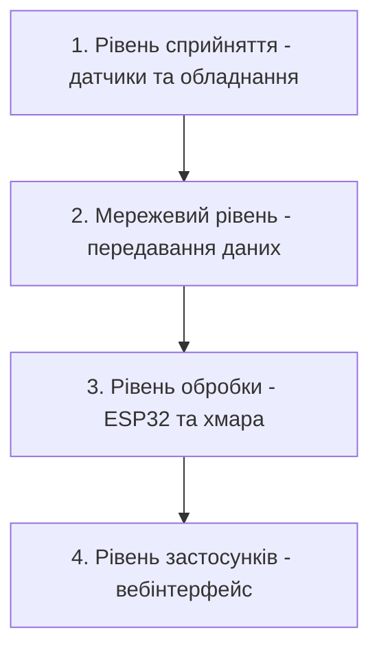

# Практична робота №1
**Студент:** Максим Братішко
**Дисципліна:** Технології IoT та SMART-технології

**Тема:** Вступ до IoT та SMART-технологій

**Варіант 1:** Розумна теплиця (200 м²)

## 1. Мета роботи

Розробити проєкт розумної теплиці площею 200 м², яка автоматично контролюватиме умови вирощування рослин та підтримуватиме необхідний мікроклімат.

## 2. Опис системи

Розумна теплиця — це IoT-система, яка за допомогою датчиків збирає інформацію про стан навколишнього середовища та автоматично керує обладнанням.

Система контролює:
- температуру повітря;
- вологість повітря;
- вологість ґрунту;
- рівень освітленості;
- концентрацію CO₂.

На основі показань датчиків система може:
- вмикати полив, якщо ґрунт занадто сухий;
- запускати вентиляцію при підвищенні температури;
- вмикати додаткове освітлення при нестачі світла;
- запускати обігрів при зниженні температури.

Керування здійснюється автоматично, але користувач також може переглядати показники та змінювати налаштування через вебінтерфейс.

## 3. Склад системи

| Пристрій | Призначення | Розміщення |
|---|---|---|
| Датчик температури та вологості повітря | Вимірювання температури й вологості | Усередині теплиці |
| Датчик вологості ґрунту | Контроль необхідності поливу | У ґрунті біля рослин |
| Датчик освітленості | Визначення рівня природного світла | У верхній частині теплиці |
| Датчик CO₂ | Контроль концентрації вуглекислого газу | У центральній частині теплиці |
| Контролер ESP32 | Збір даних та автоматичне керування | У захищеному корпусі |
| Електромагнітний клапан | Увімкнення та вимкнення поливу | На трубопроводі |
| Вентилятори | Регулювання температури та повітрообміну | У вентиляційних отворах |
| LED-світильники | Додаткове освітлення рослин | Над рослинами |
| Обігрівач | Підтримання температури | Усередині теплиці |
| Wi-Fi роутер | Передавання даних | У технічній зоні |

## 4. Архітектурна діаграма Mermaid

## 5. Обґрунтування розміщення обробки
Для розумної теплиці обрано локальну обробку даних (edge) на контролері ESP32.

Контролер отримуватиме показники датчиків і самостійно керуватиме поливом, вентиляцією, освітленням та обігрівом.

Вимога до затримки: система повинна реагувати на критичні показники протягом 5 секунд після отримання даних датчика. Саме тому обрано edge, адже для прийняття рішень не потрібне підключення до інтернету.

Хмарний сервіс використовуватиметься лише для зберігання історії вимірювань і віддаленого перегляду показників.

## 6. Розрахунок добового обсягу даних

Для розрахунку приймемо, що датчики передаватимуть показники кожні 5 хвилин.

У нашій теплиці передбачено:
•	4 датчики температури та вологості повітря;
•	4 датчики вологості ґрунту;
•	2 датчики освітленості;
•	1 датчик CO₂.

Разом — 11 датчиків.

Кількість вимірювань за добу від одного датчика:
24 × 60 / 5 = 288

Загальна кількість повідомлень за добу:
288 × 11 = 3168

Припустимо, що одне повідомлення з показником датчика, часом вимірювання та його ідентифікатором займає приблизно 100 байтів.

Добовий обсяг даних:
3168 × 100 = 316 800 байтів ≈ 317 КБ.

Отже, за добу датчики передаватимуть приблизно 317 КБ даних.
Це невеликий обсяг інформації, тому для нашої теплиці достатньо звичайного Wi-Fi-з'єднання. 

## 7. Безпека

Під час роботи розумної теплиці можуть виникати технічні проблеми або спроби стороннього втручання. Тому необхідно передбачити заходи захисту системи.

| Можлива загроза | Наслідки | Спосіб захисту |
|---|---|---|
| Несанкціонований доступ до системи | Стороння людина може змінити налаштування поливу або обігріву | Використання складних паролів та захищеного Wi-Fi-з'єднання |
| Несправність датчика | Система отримуватиме неправильні показники й може помилково ввімкнути обладнання | Перевірка показників на допустимі значення та повідомлення про несправність |
| Втрата інтернет-з'єднання | Неможливо переглядати показники та керувати теплицею віддалено | Автономна робота контролера ESP32 без підключення до хмари |
| Збій електроживлення | Припиниться робота контролера та обладнання | Резервне живлення для контролера та безпечне вимкнення виконавчих пристроїв |

Таким чином, захист системи передбачає не лише безпеку передавання даних, а й запобігання ситуаціям, які можуть зашкодити рослинам або обладнанню.

